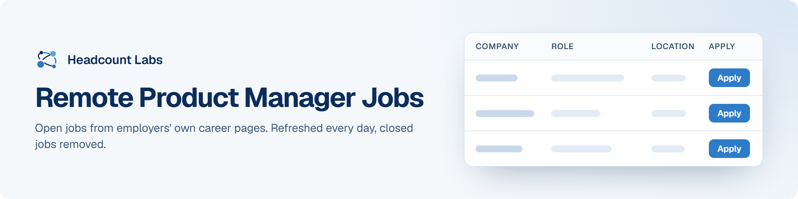

# Remote Product Manager Jobs

Remote product manager and product owner jobs at US employers.

**82 open jobs** · 0 new since the last update · 134 removed because they closed or left the employer's board · updated October 24, 2026 at 5:42 AM EDT

This list is built and refreshed every day by [Headcount Labs](https://headcountlabs.com/?utm_source=github&utm_medium=job-list&utm_campaign=remote-product-manager-jobs), which reads jobs straight from employers' own career pages and job boards. Every job here was still listed on its source board when we last read that board, within the past 3 days, and was posted in the past 30 days. Copies of the same job are merged into one row, and jobs that close are removed at the next update.

Want this data in your own app or agent? Use the [Headcount Labs jobs API](https://headcountlabs.com/docs/?utm_source=github&utm_medium=job-list&utm_campaign=remote-product-manager-jobs) (free tier), the [MCP server](https://headcountlabs.com/mcp/?utm_source=github&utm_medium=job-list&utm_campaign=remote-product-manager-jobs) for Claude, ChatGPT and other AI assistants, or the [public dataset subsets](https://huggingface.co/HeadcountLabs) on Hugging Face (the full dataset is coming soon).

**Full dataset.** A bigger, one-off snapshot dated 2026-10-19 (all matching jobs, not only the open jobs below) is on Hugging Face: [Remote jobs](https://huggingface.co/datasets/HeadcountLabs/remote-jobs). It loads with `datasets.load_dataset` and is under the Open Database License (ODbL) 1.0.

**Jump to:** [Posted in the last 7 days (43)](#posted-in-the-last-7-days) · [Posted 8 to 30 days ago (39)](#posted-8-to-30-days-ago)

**Columns.** *Apply* opens the original posting on the employer's site. *Details* opens the job on Headcount Labs, with every posting we found for it. *Remote* shows what the employer states; a dash means the posting doesn't say. *Pay* is the range the employer published.

## Posted in the last 7 days

| Company | Role | Location | Remote | Pay | Posted | Apply | Details |
| --- | --- | --- | --- | --- | --- | :---: | :---: |
| **Warner Bros. Discovery** | Advanced Product Manager | 

2 locations
Utah California
 | Remote | $122k–$228k/yr | Oct 21 |  | <a href="https://headcountlabs.com/catalog/jobs/1d46b93f-f094-4fd2-8083-a299c35b54ce?utm_source=github&utm_medium=job-list&utm_campaign=remote-product-manager-jobs">via Headcount Labs</a> |
| **ServiceNow** | Director, Regional Product Management | 

3 locations
New York City, NY Addison, TX Santa Clara, CA
 | Remote | $221k–$387k/yr | Oct 21 |  | <a href="https://headcountlabs.com/catalog/jobs/f15085a3-f9d0-40a3-8e84-5103b97410c7?utm_source=github&utm_medium=job-list&utm_campaign=remote-product-manager-jobs">via Headcount Labs</a> |
| **ServiceNow** | Senior Staff Outbound Product Manager - GTM / Data &amp; Analytics | 

2 locations
New York, NY Washington, DC
 | Remote | $191k–$334k/yr | Oct 21 |  | <a href="https://headcountlabs.com/catalog/jobs/da4ad92f-16ba-4110-968c-cd2b08b5bb3d?utm_source=github&utm_medium=job-list&utm_campaign=remote-product-manager-jobs">via Headcount Labs</a> |
| **Ralliant** | Product Manager | 

2 locations
United States Fultonville, NY
 | Remote | — | Oct 21 |  | <a href="https://headcountlabs.com/catalog/jobs/7be4f2d5-18fe-4641-b392-d44d9c0e635e?utm_source=github&utm_medium=job-list&utm_campaign=remote-product-manager-jobs">via Headcount Labs</a> |
| **Proximie** | Senior Product Manager - East Coast Remote | Orlando | Remote | — | Oct 21 |  | <a href="https://headcountlabs.com/catalog/jobs/24d98a9e-506c-4c29-964e-f8659809000e?utm_source=github&utm_medium=job-list&utm_campaign=remote-product-manager-jobs">via Headcount Labs</a> |
| **OpenLoop Health** | Senior Staff Product Manager | 

2 locations
United States Toronto
 | Remote | — | Oct 21 |  | <a href="https://headcountlabs.com/catalog/jobs/4a42e6e2-79ce-4620-8892-efb7f9d823d7?utm_source=github&utm_medium=job-list&utm_campaign=remote-product-manager-jobs">via Headcount Labs</a> |
| **NTT Global Data Centers Americas, Inc.** | Senior Director, Product Management | 

2 locations
Virginia City of London
 | Remote | $203k–$290k/yr | Oct 21 |  | <a href="https://headcountlabs.com/catalog/jobs/57b9d9c8-549c-4b18-9514-139d14b41117?utm_source=github&utm_medium=job-list&utm_campaign=remote-product-manager-jobs">via Headcount Labs</a> |
| **New Moon Production** | Product Manager – Roadmap Track (Sunshine Island) | United States | Remote | — | Oct 21 |  | <a href="https://headcountlabs.com/catalog/jobs/5d2051dd-2e6d-4d64-9fe4-f0f6913e6ff0?utm_source=github&utm_medium=job-list&utm_campaign=remote-product-manager-jobs">via Headcount Labs</a> |
| **Luxury Presence** | Staff Product Manager, Search and AI Visibility - US (Remote) | United States | Remote | $170k–$200k/yr | Oct 21 |  | <a href="https://headcountlabs.com/catalog/jobs/88e93d79-5d79-4920-962c-b8992dd55078?utm_source=github&utm_medium=job-list&utm_campaign=remote-product-manager-jobs">via Headcount Labs</a> |
| **LAM Lennar Associates Mgmt LLC** | Staff Product Manager – Finance Systems &amp; Business Solutions | 

3 locations
United States Irving, TX Miami, FL
 | Remote | — | Oct 21 |  | <a href="https://headcountlabs.com/catalog/jobs/7b2e52bc-7bf0-47b0-9e03-fe0ccbb15e9c?utm_source=github&utm_medium=job-list&utm_campaign=remote-product-manager-jobs">via Headcount Labs</a> |
| **Jobgether** | Sr. Product Manager- Financial Stewardship | United States | Remote | $140k–$168k/yr | Oct 21 |  | <a href="https://headcountlabs.com/catalog/jobs/bde2e282-c127-44ad-996d-cad8764614d8?utm_source=github&utm_medium=job-list&utm_campaign=remote-product-manager-jobs">via Headcount Labs</a> |
| **Jobgether** | Senior Product Manager, Core | United States | Remote | $170k–$208k/yr | Oct 21 |  | <a href="https://headcountlabs.com/catalog/jobs/0b07004c-a10c-4078-a57a-cdbf4f47c123?utm_source=github&utm_medium=job-list&utm_campaign=remote-product-manager-jobs">via Headcount Labs</a> |
| **Jobgether** | Principal Product Manager, Product Development Platforms | United States | Remote | $182k–$291k/yr | Oct 21 |  | <a href="https://headcountlabs.com/catalog/jobs/05de90a3-daae-423c-bde6-ccf12a99f3cd?utm_source=github&utm_medium=job-list&utm_campaign=remote-product-manager-jobs">via Headcount Labs</a> |
| **Jobgether** | Senior Product Manager, Shared Hosting | United States | Remote | $140k–$170k/yr | Oct 21 |  | <a href="https://headcountlabs.com/catalog/jobs/ffcbe105-d021-448a-8b51-362026d87701?utm_source=github&utm_medium=job-list&utm_campaign=remote-product-manager-jobs">via Headcount Labs</a> |
| **Jobgether** | Senior Product Manager - Automation Platform | United States | Remote | — | Oct 21 |  | <a href="https://headcountlabs.com/catalog/jobs/794a8a79-2ad9-45b0-a2b3-95288e96a384?utm_source=github&utm_medium=job-list&utm_campaign=remote-product-manager-jobs">via Headcount Labs</a> |
| **Jobgether** | Senior Product Manager, Epic Optimization | United States | Remote | $102k–$152k/yr | Oct 21 |  | <a href="https://headcountlabs.com/catalog/jobs/55f09780-9309-437f-9fa2-aba64d773ea7?utm_source=github&utm_medium=job-list&utm_campaign=remote-product-manager-jobs">via Headcount Labs</a> |
| **Jobgether** | Senior Product Manager | United States | Remote | — | Oct 21 |  | <a href="https://headcountlabs.com/catalog/jobs/3b3d4454-5e2f-4052-bf1b-df3e3c521854?utm_source=github&utm_medium=job-list&utm_campaign=remote-product-manager-jobs">via Headcount Labs</a> |
| **Jobgether** | Product Manager, Hardware | United States | Remote | $130k–$150k/yr | Oct 21 |  | <a href="https://headcountlabs.com/catalog/jobs/c72e9cc2-30f2-4027-9eae-4cd699acfe9b?utm_source=github&utm_medium=job-list&utm_campaign=remote-product-manager-jobs">via Headcount Labs</a> |
| **Health Care Service Corp.** | Senior Strategic Medicare Product Manager | 

3 locations
United States Nashville, TN - Nashville, TN
 | Remote | $102k–$184k/yr | Oct 21 |  | <a href="https://headcountlabs.com/catalog/jobs/a3e84b79-6c96-47ff-8cc7-9d993229e760?utm_source=github&utm_medium=job-list&utm_campaign=remote-product-manager-jobs">via Headcount Labs</a> |
| **Cribl** | Staff GTM AI Product Manager | United States | Remote | $122k–$190k/yr | Oct 21 |  | <a href="https://headcountlabs.com/catalog/jobs/4aafb6cd-773e-4c8a-91fb-57185b6ed1c0?utm_source=github&utm_medium=job-list&utm_campaign=remote-product-manager-jobs">via Headcount Labs</a> |
| **Bjak** | Product Manager - AI Stockbroking | United States | Remote | — | Oct 21 |  | <a href="https://headcountlabs.com/catalog/jobs/f957e783-7ce7-41c9-a99d-87153165a01d?utm_source=github&utm_medium=job-list&utm_campaign=remote-product-manager-jobs">via Headcount Labs</a> |
| **Bjak** | Product Manager - AI Investing | United States | Remote | — | Oct 21 |  | <a href="https://headcountlabs.com/catalog/jobs/2b7566d3-6a66-4441-820f-6d085f8f970c?utm_source=github&utm_medium=job-list&utm_campaign=remote-product-manager-jobs">via Headcount Labs</a> |
| **Bjak** | Product Manager - AI Finance | United States | Remote | — | Oct 21 |  | <a href="https://headcountlabs.com/catalog/jobs/157462c9-7225-4e6b-a0db-9faa6ce89236?utm_source=github&utm_medium=job-list&utm_campaign=remote-product-manager-jobs">via Headcount Labs</a> |
| **Bjak** | Product Owner, Technical - AI Stockbroking | United States | Remote | — | Oct 21 |  | <a href="https://headcountlabs.com/catalog/jobs/a1bc9135-f5a6-442c-b6e3-eee0f71a29e0?utm_source=github&utm_medium=job-list&utm_campaign=remote-product-manager-jobs">via Headcount Labs</a> |
| **Bjak** | Product Owner, Technical - AI Investing | United States | Remote | — | Oct 21 |  | <a href="https://headcountlabs.com/catalog/jobs/9427c791-5db1-4333-bcc4-0e0cdb71c56f?utm_source=github&utm_medium=job-list&utm_campaign=remote-product-manager-jobs">via Headcount Labs</a> |
| **Bjak** | Product Owner, Technical - AI Neobank | United States | Remote | — | Oct 21 |  | <a href="https://headcountlabs.com/catalog/jobs/2820787d-5ac0-4c1d-944b-a1750a6d414c?utm_source=github&utm_medium=job-list&utm_campaign=remote-product-manager-jobs">via Headcount Labs</a> |
| **Bjak** | Product Owner, Technical - AI Finance | United States | Remote | — | Oct 21 |  | <a href="https://headcountlabs.com/catalog/jobs/23e6844c-1e83-46c3-b55e-c332e1e820f5?utm_source=github&utm_medium=job-list&utm_campaign=remote-product-manager-jobs">via Headcount Labs</a> |
| **Bjak** | Product Manager - AI Neobank App | United States | Remote | — | Oct 21 |  | <a href="https://headcountlabs.com/catalog/jobs/4794f823-4be5-4f1b-a404-34479dcad7fa?utm_source=github&utm_medium=job-list&utm_campaign=remote-product-manager-jobs">via Headcount Labs</a> |
| **Baylor Genetics** | Senior Technical Product Manager | United States | Remote | — | Oct 21 |  | <a href="https://headcountlabs.com/catalog/jobs/8f846748-8cad-4944-85c9-810befb08599?utm_source=github&utm_medium=job-list&utm_campaign=remote-product-manager-jobs">via Headcount Labs</a> |
| **456y Varian Medical Systems UK Limited** | Technical Product Owner | 

2 locations
CEY MAD, MA
 | Remote | — | Oct 21 |  | <a href="https://headcountlabs.com/catalog/jobs/3ae5c14b-5daa-45eb-abd3-c3c8c681baa4?utm_source=github&utm_medium=job-list&utm_campaign=remote-product-manager-jobs">via Headcount Labs</a> |
| **Symmetrio** | Senior Product Manager - Radiation Oncology | United States | Remote | — | Oct 20 |  | <a href="https://headcountlabs.com/catalog/jobs/c380aba0-757a-40a0-b348-11f70a59be2c?utm_source=github&utm_medium=job-list&utm_campaign=remote-product-manager-jobs">via Headcount Labs</a> |
| **ServiceNow** | Technical Product Manager, Legal AI and Platforms | Chicago, IL | Remote | $132k–$230k/yr | Oct 20 |  | <a href="https://headcountlabs.com/catalog/jobs/f24d4624-af63-47d6-9dc1-bcf0e2d7ff99?utm_source=github&utm_medium=job-list&utm_campaign=remote-product-manager-jobs">via Headcount Labs</a> |
| **ServiceNow** | Sr Staff Outbound Product Manager - AI Assistant | Mountain View, CA | Remote | $191k–$334k/yr | Oct 20 |  | <a href="https://headcountlabs.com/catalog/jobs/a25718ff-86ca-40f6-a691-7f67f1d1c2df?utm_source=github&utm_medium=job-list&utm_campaign=remote-product-manager-jobs">via Headcount Labs</a> |
| **Robots and Pencils** | Staff Product Manager, Technical | Canada | Remote | — | Oct 20 |  | <a href="https://headcountlabs.com/catalog/jobs/b1a5e772-5c18-4160-9b20-9291bde4f606?utm_source=github&utm_medium=job-list&utm_campaign=remote-product-manager-jobs">via Headcount Labs</a> |
| **Pindrop** | Senior Product Manager, Agent Identity Management | United States | Remote | $150k–$190k/yr | Oct 20 |  | <a href="https://headcountlabs.com/catalog/jobs/d7d53176-bae2-4118-b162-8543ec20ec55?utm_source=github&utm_medium=job-list&utm_campaign=remote-product-manager-jobs">via Headcount Labs</a> |
| **Omnicell** | Sr. Product Manager | 

4 locations
United States Cranberry Township, PA Fort Worth, TX Tampa, FL
 | Remote | $185k/yr | Oct 20 |  | <a href="https://headcountlabs.com/catalog/jobs/a270ec32-37c0-42d7-927f-c9ec88bf2e5c?utm_source=github&utm_medium=job-list&utm_campaign=remote-product-manager-jobs">via Headcount Labs</a> |
| **ButterflyMX** | Sr. Product Manager, Gated Communities | United States | Remote | — | Oct 20 |  | <a href="https://headcountlabs.com/catalog/jobs/32e32f01-43f5-4a85-a532-353c5cc83dc6?utm_source=github&utm_medium=job-list&utm_campaign=remote-product-manager-jobs">via Headcount Labs</a> |
| **BambooHR** | Senior Product Manager, Agent Platform | Utah | Remote | — | Oct 20 |  | <a href="https://headcountlabs.com/catalog/jobs/e5955214-3b2b-4048-821e-21f567f11151?utm_source=github&utm_medium=job-list&utm_campaign=remote-product-manager-jobs">via Headcount Labs</a> |
| **SIC Standard Insurance Company - 3000** | Product Manager - Data &amp; AI Platform | 

2 locations
Portland, OR United States
 | Remote | $110k–$186k/yr | Oct 19 |  | <a href="https://headcountlabs.com/catalog/jobs/453c3176-4658-4440-af68-10619f55c356?utm_source=github&utm_medium=job-list&utm_campaign=remote-product-manager-jobs">via Headcount Labs</a> |
| **New Moon Production** | Product Manager – LiveOps Track (Sunshine Island) | United States | Remote | — | Oct 19 |  | <a href="https://headcountlabs.com/catalog/jobs/6db4fc20-0e52-43ea-8924-a1a661b477bf?utm_source=github&utm_medium=job-list&utm_campaign=remote-product-manager-jobs">via Headcount Labs</a> |
| **Guild Mortgage** | Product Owner, Technology | United States | Remote | $120k–$150k/yr | Oct 19 |  | <a href="https://headcountlabs.com/catalog/jobs/deaffa8f-5fb3-488a-b82b-089508e4e82f?utm_source=github&utm_medium=job-list&utm_campaign=remote-product-manager-jobs">via Headcount Labs</a> |
| **Group 1001 Resources, LLC** | Operations Data Product Owner | 

2 locations
Location United States
 | Remote | — | Oct 19 |  | <a href="https://headcountlabs.com/catalog/jobs/dd5c756c-da3e-4608-9e4b-237948c54680?utm_source=github&utm_medium=job-list&utm_campaign=remote-product-manager-jobs">via Headcount Labs</a> |
| **ClickHouse** | Senior Product Manager, Billing &amp; Marketplaces | 

9 locations
United States Charlotte Chicago Seattle Austin Atlanta New York Boston San Francisco, CA
 | Remote | $195k–$265k/yr | Oct 17 |  | <a href="https://headcountlabs.com/catalog/jobs/6327d584-e86d-499f-bfdb-372d955d9356?utm_source=github&utm_medium=job-list&utm_campaign=remote-product-manager-jobs">via Headcount Labs</a> |

## Posted 8 to 30 days ago

| Company | Role | Location | Remote | Pay | Posted | Apply | Details |
| --- | --- | --- | --- | --- | --- | :---: | :---: |
| **StarCompliance** | Product Manager - Broker Relationships | East Coast | Remote | — | Oct 16 |  | <a href="https://headcountlabs.com/catalog/jobs/f0a5a712-8017-4fe1-9e0e-3e5c3b0fcb09?utm_source=github&utm_medium=job-list&utm_campaign=remote-product-manager-jobs">via Headcount Labs</a> |
| **Monks** | Senior Product Manager | United States | Remote | $110k–$120k/yr | Oct 14 |  | <a href="https://headcountlabs.com/catalog/jobs/3b650876-d2d2-4121-b7fd-a1a4cb6385ff?utm_source=github&utm_medium=job-list&utm_campaign=remote-product-manager-jobs">via Headcount Labs</a> |
| **Versant** | Product Owner, Supply Chain &amp; Procurement | Englewood Cliffs, NJ | Remote | $110k–$130k/yr | Oct 13 |  | <a href="https://headcountlabs.com/catalog/jobs/02790459-cc08-401b-8f38-1ed544efe5dd?utm_source=github&utm_medium=job-list&utm_campaign=remote-product-manager-jobs">via Headcount Labs</a> |
| **Teamworks** | Product Manager II (Soccer) | United States | Remote | $161k/yr | Oct 13 |  | <a href="https://headcountlabs.com/catalog/jobs/d42ed606-0195-4440-9ac4-f74a1ae561ca?utm_source=github&utm_medium=job-list&utm_campaign=remote-product-manager-jobs">via Headcount Labs</a> |
| **Parallel Partners** | Senior Technical Product Manager - AI Agents, Evals &amp; Reliability, Artificial Intelligence (AI) Required, Work From Home | San Francisco, CA | Remote | $165k–$200k/yr | Oct 12 |  | <a href="https://headcountlabs.com/catalog/jobs/8527634d-29cd-4cb2-b7dd-6c2378d1db21?utm_source=github&utm_medium=job-list&utm_campaign=remote-product-manager-jobs">via Headcount Labs</a> |
| **Baylor Genetics** | Sr. Director Product Management - Oncology | United States | Remote | — | Oct 12 |  | <a href="https://headcountlabs.com/catalog/jobs/ab0c66d8-14e7-4154-b491-9067bc205d2a?utm_source=github&utm_medium=job-list&utm_campaign=remote-product-manager-jobs">via Headcount Labs</a> |
| **PracticeTek** | Sr. Product Manager - Payments | San Diego, CA | Remote | — | Oct 9 |  | <a href="https://headcountlabs.com/catalog/jobs/321c9b27-3e7a-447e-be69-edc8b5338557?utm_source=github&utm_medium=job-list&utm_campaign=remote-product-manager-jobs">via Headcount Labs</a> |
| **Instacart** | Senior Product Manager, Retailer App Platform &amp; Insights | United States | Remote | $221k–$233k/yr | Oct 9 |  | <a href="https://headcountlabs.com/catalog/jobs/b392c726-a0fd-48fb-aedd-5e0d674567cf?utm_source=github&utm_medium=job-list&utm_campaign=remote-product-manager-jobs">via Headcount Labs</a> |
| **Gainsight** | AI Product Manager | USA, TN | Remote | — | Oct 9 |  | <a href="https://headcountlabs.com/catalog/jobs/5f3cf060-47c1-42a0-a18a-b0b927d5f6aa?utm_source=github&utm_medium=job-list&utm_campaign=remote-product-manager-jobs">via Headcount Labs</a> |
| **Guidewire Software, Inc. (US)** | Senior Product Manager, PolicyCenter | United States | Remote | $148k–$254k/yr | Oct 8 |  | <a href="https://headcountlabs.com/catalog/jobs/35e08a5f-87af-41ed-bd41-2304ff0b7369?utm_source=github&utm_medium=job-list&utm_campaign=remote-product-manager-jobs">via Headcount Labs</a> |
| **Aledade PBC** | Technical Product Manager (Marketing Technology), Remote | United States | Remote | — | Oct 8 |  | <a href="https://headcountlabs.com/catalog/jobs/6a850958-0986-4f1c-b9bf-af8ebac79463?utm_source=github&utm_medium=job-list&utm_campaign=remote-product-manager-jobs">via Headcount Labs</a> |
| **Virta Health** | Senior Staff Product Manager | 

2 locations
San Francisco, CA New York, NY
 | Remote | $210k–$301k/yr | Oct 7 |  | <a href="https://headcountlabs.com/catalog/jobs/31bf0078-2a65-4dd4-a4f3-86956be01b4e?utm_source=github&utm_medium=job-list&utm_campaign=remote-product-manager-jobs">via Headcount Labs</a> |
| **Acumatica** | Director, Product Management General Business Editions | Bellevue, WA | Remote | $195k–$220k/yr | Oct 7 |  | <a href="https://headcountlabs.com/catalog/jobs/451ccd55-5b51-4d20-a911-bff8edb3991b?utm_source=github&utm_medium=job-list&utm_campaign=remote-product-manager-jobs">via Headcount Labs</a> |
| **Sardine** | Technical Product Manager - Sonar | United States | Remote | $185k–$230k/yr | Oct 6 |  | <a href="https://headcountlabs.com/catalog/jobs/5e4a19e1-ee4f-43bb-9bb3-f93b831a5695?utm_source=github&utm_medium=job-list&utm_campaign=remote-product-manager-jobs">via Headcount Labs</a> |
| **Kraken** | Senior Product Manager - Social Experience | United States | Remote | $110k–$221k/yr | Oct 6 |  | <a href="https://headcountlabs.com/catalog/jobs/f95814d8-70a0-45c6-b264-b9329e1422d3?utm_source=github&utm_medium=job-list&utm_campaign=remote-product-manager-jobs">via Headcount Labs</a> |
| **Huntress Labs** | Staff Product Manager, Core Platform &amp; UX | United States | Remote | $230k–$250k/yr | Oct 6 |  | <a href="https://headcountlabs.com/catalog/jobs/d7920d88-7541-4bea-a4db-2395e3aae1bd?utm_source=github&utm_medium=job-list&utm_campaign=remote-product-manager-jobs">via Headcount Labs</a> |
| **469g Siemens Healthcare Diagnostics Inc.** | Field Product Manager - Eastern U.S. (Territory-Based Role) | 

5 locations
United States MLV PCT PMU, ID WAS, PA
 | Remote | $116k–$160k/yr | Oct 6 |  | <a href="https://headcountlabs.com/catalog/jobs/fabb1979-a967-474b-9451-ed628fafcdab?utm_source=github&utm_medium=job-list&utm_campaign=remote-product-manager-jobs">via Headcount Labs</a> |
| **SSB002 SOUTHSTATE BANK, NATIONAL ASSOCIATION** | Salesforce Marketing Cloud Product Owner | AL, TX | Remote | $116k–$186k/yr | Oct 5 |  | <a href="https://headcountlabs.com/catalog/jobs/1ef5db18-a901-41a2-bb32-400b6f3fb01d?utm_source=github&utm_medium=job-list&utm_campaign=remote-product-manager-jobs">via Headcount Labs</a> |
| **Pillar Biosciences** | Product Manager - Global NGS Diagnostic Applications | United States | Remote | $135k–$185k/yr | Oct 5 |  | <a href="https://headcountlabs.com/catalog/jobs/b1382c5d-825f-4421-8c8f-984e3febc2a1?utm_source=github&utm_medium=job-list&utm_campaign=remote-product-manager-jobs">via Headcount Labs</a> |
| **Merge Healthcare Solutions Inc. (US)** | Portfolio Manager, Technology Product Management | 

2 locations
United States Mississauga
 | Remote | $162k–$243k/yr | Oct 5 |  | <a href="https://headcountlabs.com/catalog/jobs/71c7b1ae-9a08-4f4d-bf5e-f42b3c2bb352?utm_source=github&utm_medium=job-list&utm_campaign=remote-product-manager-jobs">via Headcount Labs</a> |
| **Kraken** | Senior Product Manager - Payments Platform | United States | Remote | $110k–$221k/yr | Oct 5 |  | <a href="https://headcountlabs.com/catalog/jobs/0b8738af-461e-4cd8-b872-5b64da161685?utm_source=github&utm_medium=job-list&utm_campaign=remote-product-manager-jobs">via Headcount Labs</a> |
| **Experian** | Product Manager, Strategic Integrations (Remote) | United States | Remote | $83k–$143k/yr | Oct 5 |  | <a href="https://headcountlabs.com/catalog/jobs/5dcd9f74-ef3d-4cf7-b3c3-1733624d281b?utm_source=github&utm_medium=job-list&utm_campaign=remote-product-manager-jobs">via Headcount Labs</a> |
| **Klarify** | Founding Product Manager | 

2 locations
United States San Francisco, CA
 | Remote | $150k–$200k/yr | Oct 3 |  | <a href="https://headcountlabs.com/catalog/jobs/c252c4f7-5421-492d-9522-d503d242364c?utm_source=github&utm_medium=job-list&utm_campaign=remote-product-manager-jobs">via Headcount Labs</a> |
| **ZMC-US DATA ZOLL Data Systems** | Director, Product Management, EMS Patient Charting Solutions | 

4 locations
Colorado Ohio Washington Wisconsin
 | Remote | $175k–$200k/yr | Oct 1 |  | <a href="https://headcountlabs.com/catalog/jobs/4aeca1b1-73db-4399-9c6c-010bf6e20204?utm_source=github&utm_medium=job-list&utm_campaign=remote-product-manager-jobs">via Headcount Labs</a> |
| **Seismic** | Senior Product Manager - Financial Services AI | United States | Remote | — | Oct 1 |  | <a href="https://headcountlabs.com/catalog/jobs/3d5e9873-ec51-4591-9cdc-b54d2fd1af6e?utm_source=github&utm_medium=job-list&utm_campaign=remote-product-manager-jobs">via Headcount Labs</a> |
| **Hims &amp; Hers** | Product Manager, Platform | United States | Remote | $200k–$235k/yr | Oct 1 |  | <a href="https://headcountlabs.com/catalog/jobs/1df93a67-56d4-43b5-894d-7d6445157818?utm_source=github&utm_medium=job-list&utm_campaign=remote-product-manager-jobs">via Headcount Labs</a> |
| **First American** | Sr. Product Management Support Analyst | Fort Mill, SC | Remote | $85k–$113k/yr | Oct 1 |  | <a href="https://headcountlabs.com/catalog/jobs/705c072b-903d-4348-826c-0be03e908e85?utm_source=github&utm_medium=job-list&utm_campaign=remote-product-manager-jobs">via Headcount Labs</a> |
| **Experian** | Director, Product Management (Remote) | United States | Remote | $158k–$284k/yr | Oct 1 |  | <a href="https://headcountlabs.com/catalog/jobs/b544089a-20f0-4837-a4c5-6c78df8aa5a7?utm_source=github&utm_medium=job-list&utm_campaign=remote-product-manager-jobs">via Headcount Labs</a> |
| **Revalize** | Product Manager B2B SaaS | United States | Remote | $130k–$145k/yr | Sep 30 |  | <a href="https://headcountlabs.com/catalog/jobs/ee5b6b16-7d8b-4e1d-bdd8-a1172cde43d3?utm_source=github&utm_medium=job-list&utm_campaign=remote-product-manager-jobs">via Headcount Labs</a> |
| **Kraken** | Product Manager II - Financial Crime Operations | United States | Remote | $96k–$192k/yr | Sep 30 |  | <a href="https://headcountlabs.com/catalog/jobs/4e10e7bb-8560-4bfb-8fa4-2d08524e5c47?utm_source=github&utm_medium=job-list&utm_campaign=remote-product-manager-jobs">via Headcount Labs</a> |
| **American Express Travel Related Services Company** | Senior Managers, Digital Product Management | New York, NY | Remote | $123k–$215k/yr | Sep 30 |  | <a href="https://headcountlabs.com/catalog/jobs/250e5ccf-3b53-4ee6-973e-1577fa4b5311?utm_source=github&utm_medium=job-list&utm_campaign=remote-product-manager-jobs">via Headcount Labs</a> |
| **vCluster Labs** | Senior Product Manager | 

2 locations
EMEA United States
 | Remote | $170k–$200k/yr | Sep 29 |  | <a href="https://headcountlabs.com/catalog/jobs/9039cccf-219a-42e2-a535-588537ec6799?utm_source=github&utm_medium=job-list&utm_campaign=remote-product-manager-jobs">via Headcount Labs</a> |
| **Akamai** | Senior Director, Product Management – AI Inferencing | 

2 locations
United States Cambridge, MA
 | Remote | $191k–$343k/yr | Sep 29 |  | <a href="https://headcountlabs.com/catalog/jobs/1305836c-799c-481c-9233-367d40c19d86?utm_source=github&utm_medium=job-list&utm_campaign=remote-product-manager-jobs">via Headcount Labs</a> |
| **Intercontinental Exchange Holdings, Inc.** | Senior Product Manager | 

2 locations
Atlanta, GA Detroit, MI
 | Remote | $75k–$160k/yr | Sep 25 |  | <a href="https://headcountlabs.com/catalog/jobs/56ea8cfe-1188-4b01-a0e5-f698b5a49655?utm_source=github&utm_medium=job-list&utm_campaign=remote-product-manager-jobs">via Headcount Labs</a> |
| **Grace Hill** | Product Manager | United States | Remote | $105k–$115k/yr | Sep 25 |  | <a href="https://headcountlabs.com/catalog/jobs/a81c6e19-5c5e-43a9-913d-81ef51c70118?utm_source=github&utm_medium=job-list&utm_campaign=remote-product-manager-jobs">via Headcount Labs</a> |
| **Emergent Holdings Career Section** | Senior Insurance Product Manager - Multiline (Remote US Residency) | 

2 locations
United States Lansing, MI
 | Remote | $120k–$195k/yr | Sep 25 |  | <a href="https://headcountlabs.com/catalog/jobs/dbdc92ef-5ccf-4483-b4c3-23315dc5d424?utm_source=github&utm_medium=job-list&utm_campaign=remote-product-manager-jobs">via Headcount Labs</a> |
| **AF Group Careers Section** | Senior Insurance Product Manager - Multiline (Remote US Residency) | 

2 locations
United States Lansing, MI
 | Remote | $120k–$195k/yr | Sep 25 |  | <a href="https://headcountlabs.com/catalog/jobs/45c059c0-b078-44ac-a9c0-8ded669e0764?utm_source=github&utm_medium=job-list&utm_campaign=remote-product-manager-jobs">via Headcount Labs</a> |
| **Kraken** | Senior Product Manager - Pro Onboarding | United States | Remote | $110k–$221k/yr | Sep 24 |  | <a href="https://headcountlabs.com/catalog/jobs/c484fa25-0f3d-489f-9bb3-07846a653f08?utm_source=github&utm_medium=job-list&utm_campaign=remote-product-manager-jobs">via Headcount Labs</a> |
| **Faith Technologies, Inc.** | Senior Product Manager - Switchboards | United States | Remote | — | Sep 24 |  | <a href="https://headcountlabs.com/catalog/jobs/76704e75-5527-4c6a-b74b-7fe3f690ff61?utm_source=github&utm_medium=job-list&utm_campaign=remote-product-manager-jobs">via Headcount Labs</a> |

## Related data on Headcount Labs

- [Product manager salary data from posted pay](https://headcountlabs.com/salary-data/product-manager/)
- [Product manager job postings dataset](https://headcountlabs.com/data/product-manager-job-postings/)
- [US job market report: open jobs by state, top employers, pay and remote share](https://headcountlabs.com/reports/us-job-market/)

## More lists from Headcount Labs

[Software Engineering Internships](https://github.com/HeadcountLabs/software-engineering-internships) · [Data Science, AI and Machine Learning Internships](https://github.com/HeadcountLabs/data-science-ai-internships) · [Engineering Internships](https://github.com/HeadcountLabs/engineering-internships) · [Business, Finance and Marketing Internships](https://github.com/HeadcountLabs/business-finance-internships) · [Internships in the US](https://github.com/HeadcountLabs/internships) · [New Grad Software Engineer Jobs](https://github.com/HeadcountLabs/new-grad-software-engineer-jobs) · [Entry-Level and New Grad Jobs](https://github.com/HeadcountLabs/entry-level-jobs) · [Entry-Level Data Analyst Jobs](https://github.com/HeadcountLabs/entry-level-data-analyst-jobs) · [Remote Software Engineer Jobs](https://github.com/HeadcountLabs/remote-software-engineer-jobs) · [Remote Data, AI and Machine Learning Jobs](https://github.com/HeadcountLabs/remote-data-jobs) · [Remote Marketing Jobs](https://github.com/HeadcountLabs/remote-marketing-jobs) · [Remote Sales Jobs](https://github.com/HeadcountLabs/remote-sales-jobs) · [Remote Customer Support and Success Jobs](https://github.com/HeadcountLabs/remote-customer-support-jobs) · [Remote Healthcare Jobs](https://github.com/HeadcountLabs/remote-healthcare-jobs) · [Remote Finance and Accounting Jobs](https://github.com/HeadcountLabs/remote-finance-accounting-jobs) · [Remote Jobs in the US](https://github.com/HeadcountLabs/remote-jobs) · [AI and Machine Learning Engineer Jobs](https://github.com/HeadcountLabs/ai-ml-engineer-jobs) · [Data Engineer Jobs](https://github.com/HeadcountLabs/data-engineer-jobs) · [Cybersecurity Jobs](https://github.com/HeadcountLabs/cybersecurity-jobs) · [Product Manager Jobs](https://github.com/HeadcountLabs/product-manager-jobs) · [Registered Nurse Jobs](https://github.com/HeadcountLabs/registered-nurse-jobs) · [Software Jobs Paying $200k+](https://github.com/HeadcountLabs/high-paying-software-jobs) · [Tech and Software Jobs in the US](https://github.com/HeadcountLabs/tech-jobs) · [Jobs with Salary Listed in the US](https://github.com/HeadcountLabs/pay-transparency-jobs) · [San Francisco Bay Area Tech Jobs](https://github.com/HeadcountLabs/bay-area-tech-jobs) · [New York City Tech Jobs](https://github.com/HeadcountLabs/new-york-tech-jobs) · [Seattle Tech Jobs](https://github.com/HeadcountLabs/seattle-tech-jobs) · [Austin Tech Jobs](https://github.com/HeadcountLabs/austin-tech-jobs) · [Boston Tech Jobs](https://github.com/HeadcountLabs/boston-tech-jobs) · [Los Angeles Tech Jobs](https://github.com/HeadcountLabs/los-angeles-tech-jobs) · [Washington, DC Tech Jobs](https://github.com/HeadcountLabs/washington-dc-tech-jobs)

## Contributing

This README is generated, so edits to it are overwritten at the next update. If a job is closed, a link is broken or a detail is wrong, [open an issue](../../issues/new) with the link and we'll fix it in the data, which fixes it everywhere. Requests for new lists are welcome too.

## License

The list data is under the [Open Database License (ODbL) 1.0](LICENSE). Our own values in it are under the [Database Contents License (DbCL) 1.0](https://opendatacommons.org/licenses/dbcl/1-0/). Credit "Headcount Labs (https://headcountlabs.com)" when you reuse it. Job description text is the employer's own text and is not licensed by us. Takedown requests: [https://headcountlabs.com/remove/](https://headcountlabs.com/remove/). Location data includes data from OpenStreetMap contributors (ODbL) and Overture Maps. The same rows are in [`data/jobs.csv`](data/jobs.csv).

Generated by Headcount Labs from the jobs API on October 24, 2026 at 5:42 AM EDT. At most 8 jobs per employer are shown in each list.
