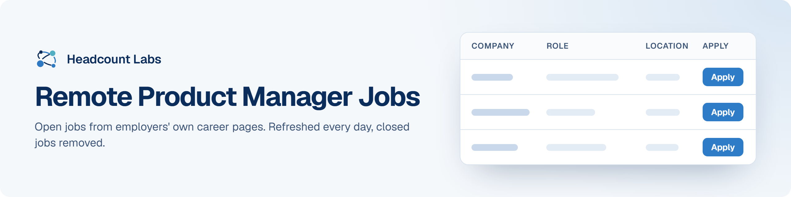

# Remote Product Manager Jobs

Remote product manager and product owner jobs at US employers.

**146 open jobs** · 110 new since the last update · 10 removed because they closed or left the employer's board · updated November 26, 2026 at 4:47 AM EST

This list is built and refreshed every day by [Headcount Labs](https://headcountlabs.com/?utm_source=github&utm_medium=job-list&utm_campaign=remote-product-manager-jobs), which reads jobs straight from employers' own career pages and job boards. Every job here was still listed on its source board when we last read that board, within the past 3 days, and was posted in the past 30 days. Copies of the same job are merged into one row, and jobs that close are removed at the next update.

Want this data in your own app or agent? Use the [Headcount Labs jobs API](https://headcountlabs.com/docs/?utm_source=github&utm_medium=job-list&utm_campaign=remote-product-manager-jobs) (free tier), the [MCP server](https://headcountlabs.com/mcp/?utm_source=github&utm_medium=job-list&utm_campaign=remote-product-manager-jobs) for Claude, ChatGPT and other AI assistants, or the [public dataset subsets](https://huggingface.co/HeadcountLabs) on Hugging Face (the full dataset is coming soon).

**Full dataset.** A bigger, one-off snapshot dated 2026-10-19 (all matching jobs, not only the open jobs below) is on Hugging Face: [Remote jobs](https://huggingface.co/datasets/HeadcountLabs/remote-jobs). It loads with `datasets.load_dataset` and is under the Open Database License (ODbL) 1.0.

**Jump to:** [Posted in the last 7 days (21)](#posted-in-the-last-7-days) · [Posted 8 to 30 days ago (125)](#posted-8-to-30-days-ago)

**Columns.** *Apply* opens the original posting on the employer's site. *Details* opens the job on Headcount Labs, with every posting we found for it. *Remote* shows what the employer states; a dash means the posting doesn't say. *Pay* is the range the employer published.

## Posted in the last 7 days

| Company | Role | Location | Remote | Pay | Posted | Apply | Details |
| --- | --- | --- | --- | --- | --- | :---: | :---: |
| **The RealReal** | Senior Product Manager, B2B &amp; Customer Support | Bellflower, CA | Remote | $170k–$189k/yr | Nov 25 |  | <a href="https://headcountlabs.com/catalog/jobs/e353db3e-bb42-4ee3-8ef6-43869d57e997?utm_source=github&utm_medium=job-list&utm_campaign=remote-product-manager-jobs">via Headcount Labs</a> |
| **Netflix** | Senior Games Product Manager | 

2 locations
United States Los Angeles, CA
 | Remote | $210k–$300k/yr | Nov 25 |  | <a href="https://headcountlabs.com/catalog/jobs/79eaf0be-b935-44bd-b031-0af95199c2a8?utm_source=github&utm_medium=job-list&utm_campaign=remote-product-manager-jobs">via Headcount Labs</a> |
| **Bjak** | Technical Product Manager | United States | Remote | — | Nov 25 |  | <a href="https://headcountlabs.com/catalog/jobs/95ea33d5-5aee-42cf-b56e-7af98b1344e6?utm_source=github&utm_medium=job-list&utm_campaign=remote-product-manager-jobs">via Headcount Labs</a> |
| **Bjak** | Product Owner, Technical - AI Investing | United States | Remote | — | Nov 25 |  | <a href="https://headcountlabs.com/catalog/jobs/9427c791-5db1-4333-bcc4-0e0cdb71c56f?utm_source=github&utm_medium=job-list&utm_campaign=remote-product-manager-jobs">via Headcount Labs</a> |
| **Bjak** | Technical Product Manager - AI Neobank | United States | Remote | — | Nov 25 |  | <a href="https://headcountlabs.com/catalog/jobs/618fe683-aabe-4780-b678-6849cd817f3c?utm_source=github&utm_medium=job-list&utm_campaign=remote-product-manager-jobs">via Headcount Labs</a> |
| **Bjak** | Product Manager - AI Stockbroking | United States | Remote | — | Nov 25 |  | <a href="https://headcountlabs.com/catalog/jobs/f957e783-7ce7-41c9-a99d-87153165a01d?utm_source=github&utm_medium=job-list&utm_campaign=remote-product-manager-jobs">via Headcount Labs</a> |
| **Bjak** | Technical Product Manager - AI Stockbroking | United States | Remote | — | Nov 25 |  | <a href="https://headcountlabs.com/catalog/jobs/cfc700b1-7eeb-48f2-b684-77d2b59239e5?utm_source=github&utm_medium=job-list&utm_campaign=remote-product-manager-jobs">via Headcount Labs</a> |
| **Bjak** | Product Owner, Technical - AI Stockbroking | United States | Remote | — | Nov 25 |  | <a href="https://headcountlabs.com/catalog/jobs/a1bc9135-f5a6-442c-b6e3-eee0f71a29e0?utm_source=github&utm_medium=job-list&utm_campaign=remote-product-manager-jobs">via Headcount Labs</a> |
| **Bjak** | Product Manager - AI Neobank App | United States | Remote | — | Nov 25 |  | <a href="https://headcountlabs.com/catalog/jobs/4794f823-4be5-4f1b-a404-34479dcad7fa?utm_source=github&utm_medium=job-list&utm_campaign=remote-product-manager-jobs">via Headcount Labs</a> |
| **Bjak** | Technical Product Manager - AI Finance | United States | Remote | — | Nov 25 |  | <a href="https://headcountlabs.com/catalog/jobs/53ed1c42-8710-4780-8e04-2769431c50e1?utm_source=github&utm_medium=job-list&utm_campaign=remote-product-manager-jobs">via Headcount Labs</a> |
| **PNC** | Alternative Investments Product Management Manager | 

3 locations
Philadelphia, PA Pennsylvania Pittsburgh, PA
 | Remote | $100k–$186k/yr | Nov 24 |  | <a href="https://headcountlabs.com/catalog/jobs/a81106e8-ee11-46ab-bfe0-58f0779155e9?utm_source=github&utm_medium=job-list&utm_campaign=remote-product-manager-jobs">via Headcount Labs</a> |
| **044 CenterWell Pharmacy, Inc.** | Senior Product Owner | 

49 locations
United States Alabama Alaska Arizona Arkansas California Colorado Connecticut Delaware Hawaii Idaho Illinois +37 more
 | Remote | $95k–$130k/yr | Nov 23 |  | <a href="https://headcountlabs.com/catalog/jobs/faf20879-7fc2-4134-8726-b76cac7691ac?utm_source=github&utm_medium=job-list&utm_campaign=remote-product-manager-jobs">via Headcount Labs</a> |
| **OpenLoop Health** | Director of Product Management | United States | Remote | — | Nov 20 |  | <a href="https://headcountlabs.com/catalog/jobs/e7f8025d-ac39-4c44-9803-c927551fcf97?utm_source=github&utm_medium=job-list&utm_campaign=remote-product-manager-jobs">via Headcount Labs</a> |
| **TEKsystems** | Product Manager | Hanover, MD | Remote | $128k–$192k/yr | Nov 19 |  | <a href="https://headcountlabs.com/catalog/jobs/7e91fd2d-fbee-4b05-9602-0d3b431fbd4d?utm_source=github&utm_medium=job-list&utm_campaign=remote-product-manager-jobs">via Headcount Labs</a> |
| **PointClickCare** | Senior Product Manager – Agentic Platform | United States | Remote | $157k–$196k/yr | Nov 19 |  | <a href="https://headcountlabs.com/catalog/jobs/7ee88aee-6198-4049-b47c-b4d3367cc3a2?utm_source=github&utm_medium=job-list&utm_campaign=remote-product-manager-jobs">via Headcount Labs</a> |
| **Jobgether** | Product Manager - Facilities Platform | United States | Remote | — | Nov 19 |  | <a href="https://headcountlabs.com/catalog/jobs/d5d96366-44b2-4b2a-be86-0162faaee044?utm_source=github&utm_medium=job-list&utm_campaign=remote-product-manager-jobs">via Headcount Labs</a> |
| **Jobgether** | Senior Product Manager | United States | Remote | — | Nov 19 |  | <a href="https://headcountlabs.com/catalog/jobs/dbf1923b-99c0-45b1-a0af-cccbd358c309?utm_source=github&utm_medium=job-list&utm_campaign=remote-product-manager-jobs">via Headcount Labs</a> |
| **Jobgether** | Product Manager, Fund OS | United States | Remote | $175k–$195k/yr | Nov 19 |  | <a href="https://headcountlabs.com/catalog/jobs/a408948e-9265-434b-97f5-d5fc89747d0e?utm_source=github&utm_medium=job-list&utm_campaign=remote-product-manager-jobs">via Headcount Labs</a> |
| **Jobgether** | Digital Product Manager - HCP Unified Experience | United States | Remote | $71/hr | Nov 19 |  | <a href="https://headcountlabs.com/catalog/jobs/4ccac6e5-72f1-4e0f-9496-24f17fa3ed18?utm_source=github&utm_medium=job-list&utm_campaign=remote-product-manager-jobs">via Headcount Labs</a> |
| **Cyncly** | Senior Product Manager – Design Flex | United States | Remote | $100k–$140k/yr | Nov 19 |  | <a href="https://headcountlabs.com/catalog/jobs/54492350-ebf2-499f-a3ee-38aba94f04aa?utm_source=github&utm_medium=job-list&utm_campaign=remote-product-manager-jobs">via Headcount Labs</a> |
| **Banner Life family of companies** | Product Manager | Frederick, MD | Remote | $109k–$140k/yr | Nov 19 |  | <a href="https://headcountlabs.com/catalog/jobs/9dfddcec-eded-48f1-9409-87f9b0e87aa1?utm_source=github&utm_medium=job-list&utm_campaign=remote-product-manager-jobs">via Headcount Labs</a> |

## Posted 8 to 30 days ago

| Company | Role | Location | Remote | Pay | Posted | Apply | Details |
| --- | --- | --- | --- | --- | --- | :---: | :---: |
| **Tillster** | Product Manager | Atlanta, GA | Remote | $115k–$130k/yr | Nov 18 |  | <a href="https://headcountlabs.com/catalog/jobs/442d88d5-9d13-43e8-b376-2e9a73fb9cab?utm_source=github&utm_medium=job-list&utm_campaign=remote-product-manager-jobs">via Headcount Labs</a> |
| **The RealReal** | Product Manager, Customer | 

2 locations
California California, CA
 | Remote | $148k–$164k/yr | Nov 18 |  | <a href="https://headcountlabs.com/catalog/jobs/d9643a9e-9942-4504-a5ea-5ca64482eff9?utm_source=github&utm_medium=job-list&utm_campaign=remote-product-manager-jobs">via Headcount Labs</a> |
| **The RealReal** | Senior Product Manager, Supply | 

2 locations
California California, CA
 | Remote | $170k–$189k/yr | Nov 18 |  | <a href="https://headcountlabs.com/catalog/jobs/6814eb96-c88f-4866-8c31-79e6e7fe6c76?utm_source=github&utm_medium=job-list&utm_campaign=remote-product-manager-jobs">via Headcount Labs</a> |
| **Marqeta** | Senior Product Manager - Flexible Credentials | 

3 locations
United States New York, NY Oakland, CA
 | Remote | — | Nov 18 |  | <a href="https://headcountlabs.com/catalog/jobs/5164bffc-d92f-4ba3-9884-b4b7e3568847?utm_source=github&utm_medium=job-list&utm_campaign=remote-product-manager-jobs">via Headcount Labs</a> |
| **Jobgether** | Group Product Manager, Customer Identity | United States | Remote | $126k–$201k/yr | Nov 18 |  | <a href="https://headcountlabs.com/catalog/jobs/d4369a2f-d37c-4a2b-a5da-8fc86c4c77fc?utm_source=github&utm_medium=job-list&utm_campaign=remote-product-manager-jobs">via Headcount Labs</a> |
| **Jobgether** | Technical Product Manager | United States | Remote | $80k–$130k/yr | Nov 18 |  | <a href="https://headcountlabs.com/catalog/jobs/d1f3e4d3-0684-4615-9985-3027587cd7d2?utm_source=github&utm_medium=job-list&utm_campaign=remote-product-manager-jobs">via Headcount Labs</a> |
| **Jobgether** | Senior Product Manager, Self-Serve | United States | Remote | — | Nov 18 |  | <a href="https://headcountlabs.com/catalog/jobs/c56577be-8e31-4c54-861c-7e24072afae2?utm_source=github&utm_medium=job-list&utm_campaign=remote-product-manager-jobs">via Headcount Labs</a> |
| **Jobgether** | Forward Deployed Product Manager | United States | Remote | $175k–$210k/yr | Nov 18 |  | <a href="https://headcountlabs.com/catalog/jobs/685edf21-231b-48ef-b2b7-bb52482a6969?utm_source=github&utm_medium=job-list&utm_campaign=remote-product-manager-jobs">via Headcount Labs</a> |
| **InStride Health** | Senior Product Manager | United States | Remote | $135k–$150k/yr | Nov 18 |  | <a href="https://headcountlabs.com/catalog/jobs/4afba14c-5974-44f3-9ffe-b43d9e7f0046?utm_source=github&utm_medium=job-list&utm_campaign=remote-product-manager-jobs">via Headcount Labs</a> |
| **Fieldguide** | Principal/Staff Product Manager, Platform | San Francisco, CA | Remote | $225k–$315k/yr | Nov 18 |  | <a href="https://headcountlabs.com/catalog/jobs/cac02007-4d5f-476e-949d-c921620931bf?utm_source=github&utm_medium=job-list&utm_campaign=remote-product-manager-jobs">via Headcount Labs</a> |
| **Docker** | Director, Product Management, Sandboxes | United States | Remote | — | Nov 18 |  | <a href="https://headcountlabs.com/catalog/jobs/c5ce6401-3f71-42f2-9174-c86865785b2f?utm_source=github&utm_medium=job-list&utm_campaign=remote-product-manager-jobs">via Headcount Labs</a> |
| **DeleteMe** | Product Manager, Consumer | United States | Remote | — | Nov 18 |  | <a href="https://headcountlabs.com/catalog/jobs/4385db36-44fb-43ee-9f65-1b9f462e6734?utm_source=github&utm_medium=job-list&utm_campaign=remote-product-manager-jobs">via Headcount Labs</a> |
| **vCluster Labs** | Staff Product Manager (AI Workloads) | 

2 locations
EMEA United States
 | Remote | $170k–$210k/yr | Nov 17 |  | <a href="https://headcountlabs.com/catalog/jobs/9039cccf-219a-42e2-a535-588537ec6799?utm_source=github&utm_medium=job-list&utm_campaign=remote-product-manager-jobs">via Headcount Labs</a> |
| **Sapio Sciences** | Product Manager | United States | Remote | $175k–$190k/yr | Nov 17 |  | <a href="https://headcountlabs.com/catalog/jobs/9f44baf2-eedb-421c-82b3-b54dfdd2af47?utm_source=github&utm_medium=job-list&utm_campaign=remote-product-manager-jobs">via Headcount Labs</a> |
| **Samsara** | Director, AI Product Management (GTM) | United States | Remote | $157k–$280k/yr | Nov 17 |  | <a href="https://headcountlabs.com/catalog/jobs/585d1e1f-a220-471c-bf4b-d190bc64edd0?utm_source=github&utm_medium=job-list&utm_campaign=remote-product-manager-jobs">via Headcount Labs</a> |
| **Mitek Systems** | Senior Product Manager – Machine Learning (Biometrics &amp; Document Intelligence) | United States | Remote | $140k–$185k/yr | Nov 17 |  | <a href="https://headcountlabs.com/catalog/jobs/be6c5fd4-a39d-40c9-a67e-a6392169765a?utm_source=github&utm_medium=job-list&utm_campaign=remote-product-manager-jobs">via Headcount Labs</a> |
| **Oportun** | Senior Director of Product Management (R14361) | United States | Remote | $175k–$280k/yr | Nov 16 |  | <a href="https://headcountlabs.com/catalog/jobs/408cc996-f4e9-4eca-a0b4-aabd97f3c9a1?utm_source=github&utm_medium=job-list&utm_campaign=remote-product-manager-jobs">via Headcount Labs</a> |
| **Olo** | Senior Product Manager, Olo App | United States | Remote | $176k–$200k/yr | Nov 16 |  | <a href="https://headcountlabs.com/catalog/jobs/06e97afc-ee96-49ed-b0cc-bbff152f77c5?utm_source=github&utm_medium=job-list&utm_campaign=remote-product-manager-jobs">via Headcount Labs</a> |
| **H&amp;R Block** | Group Product Manager, Customer Identity | Missouri | Remote | $126k–$201k/yr | Nov 16 |  | <a href="https://headcountlabs.com/catalog/jobs/735771b9-1651-4042-b7c7-adfd30d7e313?utm_source=github&utm_medium=job-list&utm_campaign=remote-product-manager-jobs">via Headcount Labs</a> |
| **Docker** | Principal Product Manager, Sandboxes | United States | Remote | — | Nov 16 |  | <a href="https://headcountlabs.com/catalog/jobs/32cc35f1-3328-4077-a0ae-b75936ea47ef?utm_source=github&utm_medium=job-list&utm_campaign=remote-product-manager-jobs">via Headcount Labs</a> |
| **Consilio LLC** | Vice President, Product Management | United States | Remote | — | Nov 16 |  | <a href="https://headcountlabs.com/catalog/jobs/366ccbea-1f5b-4e26-ae50-a1b84125235a?utm_source=github&utm_medium=job-list&utm_campaign=remote-product-manager-jobs">via Headcount Labs</a> |
| **Bounteous** | Technical AI Product Manager | United States | Remote | — | Nov 16 |  | <a href="https://headcountlabs.com/catalog/jobs/202815d1-e445-4bcf-a41a-19ad5173ae00?utm_source=github&utm_medium=job-list&utm_campaign=remote-product-manager-jobs">via Headcount Labs</a> |
| **6sense** | Sr. Product Manager | United States | Remote | $145k–$206k/yr | Nov 16 |  | <a href="https://headcountlabs.com/catalog/jobs/b249a0ae-292e-448a-b0ac-7c87c22369f6?utm_source=github&utm_medium=job-list&utm_campaign=remote-product-manager-jobs">via Headcount Labs</a> |
| **QuinStreet** | AI Product Manager | United States | Remote | — | Nov 13 |  | <a href="https://headcountlabs.com/catalog/jobs/039dbaa6-2656-4e8e-bcb0-595065fbac91?utm_source=github&utm_medium=job-list&utm_campaign=remote-product-manager-jobs">via Headcount Labs</a> |
| **PDI Technologies** | Product Owner | United States | Remote | — | Nov 13 |  | <a href="https://headcountlabs.com/catalog/jobs/3345607f-3c23-4b16-91e4-479ec22afe84?utm_source=github&utm_medium=job-list&utm_campaign=remote-product-manager-jobs">via Headcount Labs</a> |
| **Numerator** | Sr. Technical Product Manager | Chicago, IL | Remote | $117k–$161k/yr | Nov 13 |  | <a href="https://headcountlabs.com/catalog/jobs/f07dfb8a-999c-46f0-b444-78c21e623ce2?utm_source=github&utm_medium=job-list&utm_campaign=remote-product-manager-jobs">via Headcount Labs</a> |
| **Navitus Health Solutions, LLC** | Product Owner, IT | United States | Remote | $96k–$118k/yr | Nov 13 |  | <a href="https://headcountlabs.com/catalog/jobs/35afa371-8874-4e74-81a5-98efde097c9a?utm_source=github&utm_medium=job-list&utm_campaign=remote-product-manager-jobs">via Headcount Labs</a> |
| **Lyra Health** | Sr. Clinical Product Manager (Phd/PsyD) | United States | Remote | $119k–$164k/yr | Nov 13 |  | <a href="https://headcountlabs.com/catalog/jobs/c79b0a6e-31e4-4271-bf5e-95b9344cfe6b?utm_source=github&utm_medium=job-list&utm_campaign=remote-product-manager-jobs">via Headcount Labs</a> |
| **Lone Wolf Technologies** | Senior Product Manager, Agent Growth | Minneapolis, MN | Remote | $140k–$165k/yr | Nov 13 |  | <a href="https://headcountlabs.com/catalog/jobs/33e537dc-907c-45ee-9758-f72ccd5b75b8?utm_source=github&utm_medium=job-list&utm_campaign=remote-product-manager-jobs">via Headcount Labs</a> |
| **Illumio** | Director, Global Public Sector Product Management | Washington | Remote | $244k–$293k/yr | Nov 13 |  | <a href="https://headcountlabs.com/catalog/jobs/3b751678-29a8-48b0-85e2-62b0f1df6505?utm_source=github&utm_medium=job-list&utm_campaign=remote-product-manager-jobs">via Headcount Labs</a> |
| **HowGood** | Senior Product Manager - Core Products | Brooklyn, NY | Remote | $150k–$175k/yr | Nov 13 |  | <a href="https://headcountlabs.com/catalog/jobs/b7717657-f4e3-4c17-a1cc-1f69437636aa?utm_source=github&utm_medium=job-list&utm_campaign=remote-product-manager-jobs">via Headcount Labs</a> |
| **Fieldguide** | Principal/Staff Product Manager, Risk Advisory | San Francisco, CA | Remote | $225k–$315k/yr | Nov 13 |  | <a href="https://headcountlabs.com/catalog/jobs/d43a612e-010f-49a7-bfb0-308b493d5f6f?utm_source=github&utm_medium=job-list&utm_campaign=remote-product-manager-jobs">via Headcount Labs</a> |
| **Collectly** | Product Manager - Patient Experience (USA-based) | United States | Remote | $160k–$210k/yr | Nov 13 |  | <a href="https://headcountlabs.com/catalog/jobs/88396b7b-f34f-40ca-b93e-0cc1a21617ae?utm_source=github&utm_medium=job-list&utm_campaign=remote-product-manager-jobs">via Headcount Labs</a> |
| **Canals** | Senior Product Manager | 

4 locations
Denver, CO New York, NY San Francisco, CA Seattle
 | Remote | — | Nov 13 |  | <a href="https://headcountlabs.com/catalog/jobs/bdc649f2-7354-4d04-8586-504d319acd1b?utm_source=github&utm_medium=job-list&utm_campaign=remote-product-manager-jobs">via Headcount Labs</a> |
| **ABC Legal Services** | Technical Product Owner, Service of Process (SAFe) | Seattle, WA | Remote | $90k–$110k/yr | Nov 13 |  | <a href="https://headcountlabs.com/catalog/jobs/3b3baa6a-8469-4949-8497-0aa4157c80df?utm_source=github&utm_medium=job-list&utm_campaign=remote-product-manager-jobs">via Headcount Labs</a> |
| **Veeva** | Product Manager - Veeva Training | 

2 locations
Kansas City, MO Boston, MA
 | Remote | $75k–$165k/yr | Nov 12 |  | <a href="https://headcountlabs.com/catalog/jobs/4b61bc99-31ea-416d-b147-b5b0c55f662b?utm_source=github&utm_medium=job-list&utm_campaign=remote-product-manager-jobs">via Headcount Labs</a> |
| **Temporal (member)** | Staff Product Manager, Self-Hosted and Connected Temporal | 

4 locations
United States Vancouver Toronto Ottawa
 | Remote | $200k–$262k/yr | Nov 12 |  | <a href="https://headcountlabs.com/catalog/jobs/cacb5e95-892f-48d5-8013-5a64c7521c4a?utm_source=github&utm_medium=job-list&utm_campaign=remote-product-manager-jobs">via Headcount Labs</a> |
| **Quantum Health, Inc.** | Product Manager, Chronic Conditions, Wellbeing &amp; Incentives | Dublin, OH | Remote | — | Nov 12 |  | <a href="https://headcountlabs.com/catalog/jobs/55411308-2568-458a-8e17-928b073f6c02?utm_source=github&utm_medium=job-list&utm_campaign=remote-product-manager-jobs">via Headcount Labs</a> |
| **Pinterest** | Staff Product Manager, App Install | 

2 locations
San Francisco, CA Seattle, WA
 | Remote | $165k–$339k/yr | Nov 12 |  | <a href="https://headcountlabs.com/catalog/jobs/d5625110-c14f-4493-bddf-eb6ef7dbedf2?utm_source=github&utm_medium=job-list&utm_campaign=remote-product-manager-jobs">via Headcount Labs</a> |
| **Morpho** | Staff Product Manager, Institutional Credit | 

3 locations
US (EST) Paris United States
 | Remote | $220k–$290k/yr | Nov 12 |  | <a href="https://headcountlabs.com/catalog/jobs/607dacc0-e199-434c-b2fc-d05d1b40860f?utm_source=github&utm_medium=job-list&utm_campaign=remote-product-manager-jobs">via Headcount Labs</a> |
| **Mimica** | Lead/Staff Product Manager (AI Automation) &#124; Remote | 

6 locations
London Edinburgh Dublin Amsterdam Barcelona New York, NY
 | Remote | — | Nov 12 |  | <a href="https://headcountlabs.com/catalog/jobs/25690f5f-119b-411d-b15d-3bdd2aa1537d?utm_source=github&utm_medium=job-list&utm_campaign=remote-product-manager-jobs">via Headcount Labs</a> |
| **MeridianLink** | Sr. Product Manager - AI Products (FinTech) | United States | Remote | $139k–$197k/yr | Nov 12 |  | <a href="https://headcountlabs.com/catalog/jobs/7bb25982-5ecf-422c-94cf-b2c03fe1f1e8?utm_source=github&utm_medium=job-list&utm_campaign=remote-product-manager-jobs">via Headcount Labs</a> |
| **Dragos** | Senior Product Manager, Protocol and Asset Identification (Electric) | United States | Remote | $180k/yr | Nov 12 |  | <a href="https://headcountlabs.com/catalog/jobs/777be932-5f02-4a20-93b4-4978b7c0796a?utm_source=github&utm_medium=job-list&utm_campaign=remote-product-manager-jobs">via Headcount Labs</a> |
| **BLOCKCHAIN CAPITAL, LLC** | Sr Product Manager - Virality, Referrals &amp; KOL | United States | Remote | $110k–$221k/yr | Nov 12 |  | <a href="https://headcountlabs.com/catalog/jobs/0892ee4b-1d00-4f34-baac-09ec3bf682b5?utm_source=github&utm_medium=job-list&utm_campaign=remote-product-manager-jobs">via Headcount Labs</a> |
| **Zoom** | Senior Product Manager, Analytics and Insights | Boston, MA | Remote | $124k–$271k/yr | Nov 11 |  | <a href="https://headcountlabs.com/catalog/jobs/ed40fecd-0632-438d-bd50-2a30b4bc9537?utm_source=github&utm_medium=job-list&utm_campaign=remote-product-manager-jobs">via Headcount Labs</a> |
| **Xylem** | Product Manager Data Lake and Data Science | Morrisville, NC | Remote | $130k/yr | Nov 11 |  | <a href="https://headcountlabs.com/catalog/jobs/74c754b3-824b-4c07-9d63-c70f5cc63d07?utm_source=github&utm_medium=job-list&utm_campaign=remote-product-manager-jobs">via Headcount Labs</a> |
| **Vultr** | Senior Product Manager, Observability | United States | Remote | — | Nov 11 |  | <a href="https://headcountlabs.com/catalog/jobs/c6255ff2-b5a0-4d84-8250-8097e9e04aa9?utm_source=github&utm_medium=job-list&utm_campaign=remote-product-manager-jobs">via Headcount Labs</a> |
| **TE Connectivity** | SR MGR PRODUCT MANAGEMENT (Remote) | United States | Remote | $166k–$249k/yr | Nov 11 |  | <a href="https://headcountlabs.com/catalog/jobs/5fd35ed9-991c-42ed-9cfd-66d17b1859ab?utm_source=github&utm_medium=job-list&utm_campaign=remote-product-manager-jobs">via Headcount Labs</a> |
| **Innovative Systems** | Product Manager-Data Quality | Pittsburgh, PA | Remote | — | Nov 11 |  | <a href="https://headcountlabs.com/catalog/jobs/e4e2b462-4a9e-48fc-9468-4e7e5326b295?utm_source=github&utm_medium=job-list&utm_campaign=remote-product-manager-jobs">via Headcount Labs</a> |
| **IEWC** | Product Manager, Power Solutions | Carrollton, TX | Remote | — | Nov 11 |  | <a href="https://headcountlabs.com/catalog/jobs/9f50f345-09fe-4fb7-af81-bbe73057e18e?utm_source=github&utm_medium=job-list&utm_campaign=remote-product-manager-jobs">via Headcount Labs</a> |
| **PointClickCare** | Sr. Product Manager -Senior Living | United States | Remote | $132k–$166k/yr | Nov 10 |  | <a href="https://headcountlabs.com/catalog/jobs/269af49e-55fe-42bb-922e-597dcc595965?utm_source=github&utm_medium=job-list&utm_campaign=remote-product-manager-jobs">via Headcount Labs</a> |
| **PAR Technology** | Product Manager, IDR | United States | Remote | $100k–$120k/yr | Nov 10 |  | <a href="https://headcountlabs.com/catalog/jobs/4bd2313e-7674-413e-ba06-5db8a23d9e76?utm_source=github&utm_medium=job-list&utm_campaign=remote-product-manager-jobs">via Headcount Labs</a> |
| **Experian** | Vice President, Product Management | United States | Remote | — | Nov 10 |  | <a href="https://headcountlabs.com/catalog/jobs/c775ff7b-dd80-416d-b040-cc9ebfa046a1?utm_source=github&utm_medium=job-list&utm_campaign=remote-product-manager-jobs">via Headcount Labs</a> |
| **Dragos** | Senior Technical Product Manager, Collection Management | United States | Remote | $180k/yr | Nov 10 |  | <a href="https://headcountlabs.com/catalog/jobs/25f356fc-cbdd-4b4f-a8b9-b2f3d7e063c1?utm_source=github&utm_medium=job-list&utm_campaign=remote-product-manager-jobs">via Headcount Labs</a> |
| **Change.org** | Sr. Product Manager, Internal Tools &amp; Analysis | United States | Remote | — | Nov 10 |  | <a href="https://headcountlabs.com/catalog/jobs/0f1735ec-e7af-4d88-b713-6d0303bfabaa?utm_source=github&utm_medium=job-list&utm_campaign=remote-product-manager-jobs">via Headcount Labs</a> |
| **American Heart Association** | Product Manager | Dallas, TX | Remote | $90k–$100k/yr | Nov 10 |  | <a href="https://headcountlabs.com/catalog/jobs/1182a018-a631-40e7-89e3-d8d8c619fc4e?utm_source=github&utm_medium=job-list&utm_campaign=remote-product-manager-jobs">via Headcount Labs</a> |
| **Grafana Labs** | Senior Product Manager, App o11y &#124; US &#124; Remote | United States | Remote | $167k–$201k/yr | Nov 9 |  | <a href="https://headcountlabs.com/catalog/jobs/d6fb24c0-6249-4305-84c7-4b7ca245d939?utm_source=github&utm_medium=job-list&utm_campaign=remote-product-manager-jobs">via Headcount Labs</a> |
| **Delinea** | Senior Product Manager - Non-Human Identity Security | United States | Remote | $145k–$162k/yr | Nov 9 |  | <a href="https://headcountlabs.com/catalog/jobs/5e4f9d30-0d93-4ebb-a4b9-ec63300055b4?utm_source=github&utm_medium=job-list&utm_campaign=remote-product-manager-jobs">via Headcount Labs</a> |
| **CIVCO Medical Solutions** | Upstream Product Manager | United States | Remote | $110k–$165k/yr | Nov 9 |  | <a href="https://headcountlabs.com/catalog/jobs/46dfb6e8-4ecc-4042-acb8-3a4e5e262dfe?utm_source=github&utm_medium=job-list&utm_campaign=remote-product-manager-jobs">via Headcount Labs</a> |
| **Zscaler** | Principal Product Manager | United States | Remote | $172k–$245k/yr | Nov 6 |  | <a href="https://headcountlabs.com/catalog/jobs/5d35121a-a650-4f48-9e95-f4a0bc81be76?utm_source=github&utm_medium=job-list&utm_campaign=remote-product-manager-jobs">via Headcount Labs</a> |
| **Xsolla** | Senior Product Manager - Xsolla Ads &amp; Rewards | United States | Remote | $150k–$190k/yr | Nov 6 |  | <a href="https://headcountlabs.com/catalog/jobs/beafc9c7-ec14-41ff-8aab-1b11f0ea4384?utm_source=github&utm_medium=job-list&utm_campaign=remote-product-manager-jobs">via Headcount Labs</a> |
| **Upstart** | Senior Product Manager | United States | Remote | $162k–$224k/yr | Nov 6 |  | <a href="https://headcountlabs.com/catalog/jobs/ee6066ba-09a6-4713-918d-8d999d54b1b4?utm_source=github&utm_medium=job-list&utm_campaign=remote-product-manager-jobs">via Headcount Labs</a> |
| **MoneyGram** | Product Manager, Digital Money Transfer | United States | Remote | — | Nov 6 |  | <a href="https://headcountlabs.com/catalog/jobs/930d3e66-4778-4b99-913b-b6de1e867a0b?utm_source=github&utm_medium=job-list&utm_campaign=remote-product-manager-jobs">via Headcount Labs</a> |
| **Future Works** | Senior AI Product Manager (CRE) | 

2 locations
United States New York, NY
 | Remote | — | Nov 6 |  | <a href="https://headcountlabs.com/catalog/jobs/1662ecaf-45d3-40ca-8b4e-180ea4f81b58?utm_source=github&utm_medium=job-list&utm_campaign=remote-product-manager-jobs">via Headcount Labs</a> |
| **Coinbase** | Senior Product Manager, Payments &amp; TRUST Network | United States | Remote | $207k–$244k/yr | Nov 6 |  | <a href="https://headcountlabs.com/catalog/jobs/8e48a4ea-a80d-4516-b3d4-dc75a55f1f2c?utm_source=github&utm_medium=job-list&utm_campaign=remote-product-manager-jobs">via Headcount Labs</a> |
| **Affirm** | Director, Product Management (Consumer) | United States | Remote | $300k–$360k/yr | Nov 6 |  | <a href="https://headcountlabs.com/catalog/jobs/93e75443-639f-47df-a464-026f8840a7c9?utm_source=github&utm_medium=job-list&utm_campaign=remote-product-manager-jobs">via Headcount Labs</a> |
| **Wayfinder** | Product Manager | United States | Remote | — | Nov 5 |  | <a href="https://headcountlabs.com/catalog/jobs/79103a93-c43d-45f6-9ce6-143838b078a7?utm_source=github&utm_medium=job-list&utm_campaign=remote-product-manager-jobs">via Headcount Labs</a> |
| **Vanta** | Senior Product Manager, GRC Platform | United States | Remote | $207k–$244k/yr | Nov 5 |  | <a href="https://headcountlabs.com/catalog/jobs/740d84f1-803f-4be5-829c-4a2d4f28d228?utm_source=github&utm_medium=job-list&utm_campaign=remote-product-manager-jobs">via Headcount Labs</a> |
| **Vanta** | Senior Product Manager, Organizational Units | United States | Remote | $207k–$244k/yr | Nov 5 |  | <a href="https://headcountlabs.com/catalog/jobs/50eb9cd7-0c2f-4fdb-af20-2c76626c35bb?utm_source=github&utm_medium=job-list&utm_campaign=remote-product-manager-jobs">via Headcount Labs</a> |
| **Serve Robotics** | Senior Product Manager, Operations &amp; Commercialization | 

7 locations
United States Montreal Calgary Toronto Ottawa Surrey Vancouver
 | Remote | $165k–$195k/yr | Nov 5 |  | <a href="https://headcountlabs.com/catalog/jobs/e78c8be7-29f2-4a44-92b4-18a38b88f589?utm_source=github&utm_medium=job-list&utm_campaign=remote-product-manager-jobs">via Headcount Labs</a> |
| **PointClickCare** | Principal Product Manager, Revenue Cycle Management | United States | Remote | $156k–$195k/yr | Nov 5 |  | <a href="https://headcountlabs.com/catalog/jobs/40f6a43f-2fe4-49de-979c-fc79154d0e28?utm_source=github&utm_medium=job-list&utm_campaign=remote-product-manager-jobs">via Headcount Labs</a> |
| **OppFi** | Product Manager | United States | Remote | $102k–$154k/yr | Nov 5 |  | <a href="https://headcountlabs.com/catalog/jobs/e67fd227-bc74-4222-8604-5b68eefd31ba?utm_source=github&utm_medium=job-list&utm_campaign=remote-product-manager-jobs">via Headcount Labs</a> |
| **Inovalon** | Senior Product Manager (STARS) | United States | Remote | $113k–$150k/yr | Nov 5 |  | <a href="https://headcountlabs.com/catalog/jobs/e67b6f6e-9f27-4769-b0ce-93419bdded6e?utm_source=github&utm_medium=job-list&utm_campaign=remote-product-manager-jobs">via Headcount Labs</a> |
| **H&amp;R Block** | Senior Product Manager, Spruce | Missouri | Remote | $101k–$162k/yr | Nov 5 |  | <a href="https://headcountlabs.com/catalog/jobs/ca02ee77-6b28-4829-86d3-4b3b28a5747f?utm_source=github&utm_medium=job-list&utm_campaign=remote-product-manager-jobs">via Headcount Labs</a> |
| **Finalsite** | Senior Product Manager | Glastonbury, CT | Remote | — | Nov 5 |  | <a href="https://headcountlabs.com/catalog/jobs/0a0745f5-79a3-4504-9b1d-a0e69dd80b30?utm_source=github&utm_medium=job-list&utm_campaign=remote-product-manager-jobs">via Headcount Labs</a> |
| **Coinbase** | Payments Infrastructure Product Manager | United States | Remote | $180k–$212k/yr | Nov 5 |  | <a href="https://headcountlabs.com/catalog/jobs/82d832fa-796f-4fef-8910-ea9514bd4a71?utm_source=github&utm_medium=job-list&utm_campaign=remote-product-manager-jobs">via Headcount Labs</a> |
| **Cohere** | Product Manager, Inference Platform | 

2 locations
Toronto United States
 | Remote | $230k–$375k/yr | Nov 5 |  | <a href="https://headcountlabs.com/catalog/jobs/9bbc5114-74ea-4832-b568-0fcdcb3125c2?utm_source=github&utm_medium=job-list&utm_campaign=remote-product-manager-jobs">via Headcount Labs</a> |
| **Seismic** | Director, Product Management (Manufacturing Vertical) | United States | Remote | — | Nov 4 |  | <a href="https://headcountlabs.com/catalog/jobs/f6900acd-a70b-4acf-8fb5-a727511a0cc5?utm_source=github&utm_medium=job-list&utm_campaign=remote-product-manager-jobs">via Headcount Labs</a> |
| **NerdWallet** | Staff Data Product Manager (Machine Learning) | NerdWallet US | Remote | $140k–$246k/yr | Nov 4 |  | <a href="https://headcountlabs.com/catalog/jobs/6e2f74eb-ef08-4edc-9b52-61c659569c2f?utm_source=github&utm_medium=job-list&utm_campaign=remote-product-manager-jobs">via Headcount Labs</a> |
| **Fieldguide** | Lead/Principal/Staff Product Manager, Corporate Internal Audit | San Francisco, CA | Remote | $200k–$315k/yr | Nov 4 |  | <a href="https://headcountlabs.com/catalog/jobs/e36583e3-2424-4a23-9fcf-9e09cb9dacf4?utm_source=github&utm_medium=job-list&utm_campaign=remote-product-manager-jobs">via Headcount Labs</a> |
| **Fieldguide** | Lead/Principal Product Manager, Tax Agents | San Francisco, CA | Remote | $205k–$275k/yr | Nov 4 |  | <a href="https://headcountlabs.com/catalog/jobs/2b6099e4-3027-4426-9d9e-2e89a9c165dd?utm_source=github&utm_medium=job-list&utm_campaign=remote-product-manager-jobs">via Headcount Labs</a> |
| **Basis Technologies** | Sr Technical Product Manager - Identity | United States | Remote | $119k–$173k/yr | Nov 4 |  | <a href="https://headcountlabs.com/catalog/jobs/d8a53fa2-8647-406f-92cf-53d69eb25933?utm_source=github&utm_medium=job-list&utm_campaign=remote-product-manager-jobs">via Headcount Labs</a> |
| **vCluster Labs** | Staff Product Manager (vMetal) | 

2 locations
EMEA United States
 | Remote | $170k–$210k/yr | Nov 3 |  | <a href="https://headcountlabs.com/catalog/jobs/ffcafb61-d677-4943-b947-41bd4c31e9cb?utm_source=github&utm_medium=job-list&utm_campaign=remote-product-manager-jobs">via Headcount Labs</a> |
| **Siftwell Analytics** | Product Manager | Charlotte, NC | Remote | $130k–$140k/yr | Nov 3 |  | <a href="https://headcountlabs.com/catalog/jobs/ad0796f8-6be8-4b6a-9801-b3b82c3444ed?utm_source=github&utm_medium=job-list&utm_campaign=remote-product-manager-jobs">via Headcount Labs</a> |
| **Pivotal Health** | Product Manager (Case Strategy) | 

3 locations
United States Williamsburg, NY Santa Monica, CA
 | Remote | $145k–$170k/yr | Nov 3 |  | <a href="https://headcountlabs.com/catalog/jobs/569e2413-b395-4c20-b298-87d7bedac6aa?utm_source=github&utm_medium=job-list&utm_campaign=remote-product-manager-jobs">via Headcount Labs</a> |
| **OpenLoop Health** | Senior Staff Product Manager | 

2 locations
United States Toronto
 | Remote | — | Nov 3 |  | <a href="https://headcountlabs.com/catalog/jobs/4a42e6e2-79ce-4620-8892-efb7f9d823d7?utm_source=github&utm_medium=job-list&utm_campaign=remote-product-manager-jobs">via Headcount Labs</a> |
| **Flashpoint** | Staff Product Manager | in the United States | Remote | — | Nov 3 |  | <a href="https://headcountlabs.com/catalog/jobs/355078ae-920b-421f-b84e-a3e2e07cb825?utm_source=github&utm_medium=job-list&utm_campaign=remote-product-manager-jobs">via Headcount Labs</a> |
| **Westfield** | Small Business State Product Management Analyst | Westfield Center, OH | Remote | — | Nov 2 |  | <a href="https://headcountlabs.com/catalog/jobs/c0d93491-b533-46ae-bfbb-c6f70a533285?utm_source=github&utm_medium=job-list&utm_campaign=remote-product-manager-jobs">via Headcount Labs</a> |
| **SupplyHouse.com** | Technical Product Manager - AI | United States | Remote | $122k–$152k/yr | Nov 2 |  | <a href="https://headcountlabs.com/catalog/jobs/dd7daf68-8e57-49e3-ae7a-1799c48fd78b?utm_source=github&utm_medium=job-list&utm_campaign=remote-product-manager-jobs">via Headcount Labs</a> |
| **Inception Family** | Product Manager | 

2 locations
Houston, TX Franklin, TN
 | Remote | — | Nov 2 |  | <a href="https://headcountlabs.com/catalog/jobs/1d7bbfb9-23cc-4443-afa4-0a9a34bb6888?utm_source=github&utm_medium=job-list&utm_campaign=remote-product-manager-jobs">via Headcount Labs</a> |
| **Counterpart Health** | Staff Product Manager, Longitudinal Patient Record | United States | Remote | $188k–$245k/yr | Nov 2 |  | <a href="https://headcountlabs.com/catalog/jobs/f6e9f9b2-2fcf-4eb6-a533-d6957106e437?utm_source=github&utm_medium=job-list&utm_campaign=remote-product-manager-jobs">via Headcount Labs</a> |
| **Clover Health** | Staff Product Manager, Longitudinal Patient Record | United States | Remote | $188k–$245k/yr | Nov 2 |  | <a href="https://headcountlabs.com/catalog/jobs/05f9ed02-261f-45b6-ac1e-9dad4d8b0722?utm_source=github&utm_medium=job-list&utm_campaign=remote-product-manager-jobs">via Headcount Labs</a> |
| **Steampunk** | Product Owner/Application Lead | McLean, VA | Remote | $75k–$150k/yr | Nov 1 |  | <a href="https://headcountlabs.com/catalog/jobs/ebeff17d-efc9-4a18-9a86-7301558bf941?utm_source=github&utm_medium=job-list&utm_campaign=remote-product-manager-jobs">via Headcount Labs</a> |
| **Steampunk** | Medallia Customer Experience Strategist / Product Owner | McLean, VA | Remote | $140k–$170k/yr | Nov 1 |  | <a href="https://headcountlabs.com/catalog/jobs/a31d2f08-8252-47d6-ba36-e7e4b2a65c4c?utm_source=github&utm_medium=job-list&utm_campaign=remote-product-manager-jobs">via Headcount Labs</a> |
| **Steampunk** | Senior Product Owner | McLean, VA | Remote | $75k–$150k/yr | Nov 1 |  | <a href="https://headcountlabs.com/catalog/jobs/26ab3766-9e5f-476e-84b3-7d621e650049?utm_source=github&utm_medium=job-list&utm_campaign=remote-product-manager-jobs">via Headcount Labs</a> |
| **TE Connectivity** | Personalization and Experience Product Owner | United States | Remote | $145k–$181k/yr | Oct 31 |  | <a href="https://headcountlabs.com/catalog/jobs/8f2a26c5-f375-4b8a-97cc-6a42276b813d?utm_source=github&utm_medium=job-list&utm_campaign=remote-product-manager-jobs">via Headcount Labs</a> |
| **Mechanism Ventures** | Growth Product Manager | United States | Remote | $170k–$200k/yr | Oct 31 |  | <a href="https://headcountlabs.com/catalog/jobs/742470e1-6f5f-46d0-9c1e-059df494962d?utm_source=github&utm_medium=job-list&utm_campaign=remote-product-manager-jobs">via Headcount Labs</a> |
| **Veeva** | Senior Product Manager - Digital Asset Management | Boston, MA | Remote | $120k–$200k/yr | Oct 30 |  | <a href="https://headcountlabs.com/catalog/jobs/46f2cf25-33c7-4257-ba5a-20d48d00e133?utm_source=github&utm_medium=job-list&utm_campaign=remote-product-manager-jobs">via Headcount Labs</a> |
| **TriEdge Investments** | Senior Product Manager, Value-Based Care Platforms | United States | Remote | — | Oct 30 |  | <a href="https://headcountlabs.com/catalog/jobs/dc09995f-0f30-4c8d-9fa0-9dcd9e7dcf7d?utm_source=github&utm_medium=job-list&utm_campaign=remote-product-manager-jobs">via Headcount Labs</a> |
| **Teamworks** | Product Management MBA Intern | United States | Remote | $50–$60/hr | Oct 30 |  | <a href="https://headcountlabs.com/catalog/jobs/47e0069b-90d1-4a92-b676-eae3431db57e?utm_source=github&utm_medium=job-list&utm_campaign=remote-product-manager-jobs">via Headcount Labs</a> |
| **Seismic** | Senior Product Manager, Seismic Learning | United States | Remote | — | Oct 30 |  | <a href="https://headcountlabs.com/catalog/jobs/82b6f5f5-a763-426c-8169-4cf3c75aed9b?utm_source=github&utm_medium=job-list&utm_campaign=remote-product-manager-jobs">via Headcount Labs</a> |
| **RELX INC** | Product Manager, Property Intelligence | United States | Remote | $95k–$159k/yr | Oct 30 |  | <a href="https://headcountlabs.com/catalog/jobs/c7c986c7-a006-4339-89e7-15fdd7955bb9?utm_source=github&utm_medium=job-list&utm_campaign=remote-product-manager-jobs">via Headcount Labs</a> |
| **Ontrac Solutions** | Product Manager (New Product Development) | Chicago, IL | Remote | — | Oct 30 |  | <a href="https://headcountlabs.com/catalog/jobs/bd61b653-bf53-4d6f-88a5-0b08e3d286c0?utm_source=github&utm_medium=job-list&utm_campaign=remote-product-manager-jobs">via Headcount Labs</a> |
| **Kiddom** | ELA Content Product Manager | United States | Remote | $70k–$90k/yr | Oct 30 |  | <a href="https://headcountlabs.com/catalog/jobs/89fd072e-ce18-4731-88c2-673bbd4ac16e?utm_source=github&utm_medium=job-list&utm_campaign=remote-product-manager-jobs">via Headcount Labs</a> |
| **Bureau** | Senior Product Manager - Credit Risk | 

3 locations
Southeast Asia United States EMEA
 | Remote | — | Oct 30 |  | <a href="https://headcountlabs.com/catalog/jobs/e90d38b6-c041-48de-8d1f-2ad67affe785?utm_source=github&utm_medium=job-list&utm_campaign=remote-product-manager-jobs">via Headcount Labs</a> |
| **Xsolla** | Product Manager, Xsolla Ads | United States | Remote | $135k–$175k/yr | Oct 29 |  | <a href="https://headcountlabs.com/catalog/jobs/e70cfd91-d4b7-4ce1-9c18-23f85d8f8e74?utm_source=github&utm_medium=job-list&utm_campaign=remote-product-manager-jobs">via Headcount Labs</a> |
| **Vanta** | Senior Product Manager, Commitments | United States | Remote | $207k–$244k/yr | Oct 29 |  | <a href="https://headcountlabs.com/catalog/jobs/d931ea59-52a3-4e7a-82bf-1887ead2e1c5?utm_source=github&utm_medium=job-list&utm_campaign=remote-product-manager-jobs">via Headcount Labs</a> |
| **OpenRouter** | Product Manager, Provider Marketplace | United States | Remote | — | Oct 29 |  | <a href="https://headcountlabs.com/catalog/jobs/3ccf0400-ae8b-4b2d-b489-460d30c37c5a?utm_source=github&utm_medium=job-list&utm_campaign=remote-product-manager-jobs">via Headcount Labs</a> |
| **Mapbox** | Product Manager II, Maps AI | Mapbox US | Remote | — | Oct 29 |  | <a href="https://headcountlabs.com/catalog/jobs/03097740-1ff8-4e8e-9baa-03e2d0eda1ed?utm_source=github&utm_medium=job-list&utm_campaign=remote-product-manager-jobs">via Headcount Labs</a> |
| **Infobase** | Product Manager, Careers | United States | Remote | $110k–$150k/yr | Oct 29 |  | <a href="https://headcountlabs.com/catalog/jobs/6a185710-4ef2-4cf4-b3cd-56636ff2ddc0?utm_source=github&utm_medium=job-list&utm_campaign=remote-product-manager-jobs">via Headcount Labs</a> |
| **BOLD** | Senior Product Manager II (Growth &amp; Traffic) | United States | Remote | $150k–$190k/yr | Oct 29 |  | <a href="https://headcountlabs.com/catalog/jobs/1f07bee6-431b-49c5-b6c2-0c79a9697a3e?utm_source=github&utm_medium=job-list&utm_campaign=remote-product-manager-jobs">via Headcount Labs</a> |
| **Binance.US** | Product Manager, Trust, Risk &amp; Platform | United States | Remote | — | Oct 29 |  | <a href="https://headcountlabs.com/catalog/jobs/1cb0981c-f0d2-42d8-a321-abc8d1511c17?utm_source=github&utm_medium=job-list&utm_campaign=remote-product-manager-jobs">via Headcount Labs</a> |
| **Yoh** | Product Manager – Autonomous Mobility/ Commercial Auto Insurance | 

3 locations
Costa Mesa, CA Texas Dallas, TX
 | Remote | $194k–$259k/yr | Oct 28 |  | <a href="https://headcountlabs.com/catalog/jobs/fe2d0bfd-5cf9-4973-a2cb-edabb988c65b?utm_source=github&utm_medium=job-list&utm_campaign=remote-product-manager-jobs">via Headcount Labs</a> |
| **Versapay** | Senior Product Manager, Payments Gateway | United States | Remote | $160k–$180k/yr | Oct 28 |  | <a href="https://headcountlabs.com/catalog/jobs/de836176-8123-4b95-b88c-457ce7e75d7e?utm_source=github&utm_medium=job-list&utm_campaign=remote-product-manager-jobs">via Headcount Labs</a> |
| **Rubrik** | Staff Product Manager, Databases | 

54 locations
Carson City, NV Boise, ID Pierre, SD Jefferson City, MO Trenton, NJ Columbia, SC Springfield, IL Cheyenne, WY Oklahoma City, OK Lincoln, NE Richmond, VA Hagatna +42 more
 | Remote | $211k–$317k/yr | Oct 28 |  | <a href="https://headcountlabs.com/catalog/jobs/90d0661a-d20c-4bb3-983e-058da4cf0c61?utm_source=github&utm_medium=job-list&utm_campaign=remote-product-manager-jobs">via Headcount Labs</a> |
| **OnePay** | Product Manager, Pay Later | United States | Remote | $180k–$220k/yr | Oct 28 |  | <a href="https://headcountlabs.com/catalog/jobs/6dc15eaf-09fb-4f55-84ad-9ec7f90e80c4?utm_source=github&utm_medium=job-list&utm_campaign=remote-product-manager-jobs">via Headcount Labs</a> |
| **Lightspeed Commerce, Inc.** | Director, Product Management (Instore Selling) | New York, NY | Remote | $220k–$255k/yr | Oct 28 |  | <a href="https://headcountlabs.com/catalog/jobs/d9802b94-895e-4d2a-bcd6-d398b1b6918b?utm_source=github&utm_medium=job-list&utm_campaign=remote-product-manager-jobs">via Headcount Labs</a> |
| **Circana** | Sr. Product Manager, Product Operations &amp; Insights&#124; US: Remote | United States | Remote | $150k–$159k/yr | Oct 28 |  | <a href="https://headcountlabs.com/catalog/jobs/cd607e87-4c39-4371-8b7c-f5f974456758?utm_source=github&utm_medium=job-list&utm_campaign=remote-product-manager-jobs">via Headcount Labs</a> |
| **Circana** | Senior Product Manager, AI Products &amp; Commercialization&#124; US: Remote | United States | Remote | $150k–$159k/yr | Oct 28 |  | <a href="https://headcountlabs.com/catalog/jobs/744596bc-73ac-4858-92dd-b6b70b9de980?utm_source=github&utm_medium=job-list&utm_campaign=remote-product-manager-jobs">via Headcount Labs</a> |
| **Circana** | Senior Product Manager, AI Workflow Design&#124; US: Remote | United States | Remote | $125k/yr | Oct 28 |  | <a href="https://headcountlabs.com/catalog/jobs/5cddc1af-6167-41d3-adcb-eab03728d099?utm_source=github&utm_medium=job-list&utm_campaign=remote-product-manager-jobs">via Headcount Labs</a> |
| **Circana** | Senior Product Manager, AI Evaluation &amp; Quality&#124; Level 18&#124; US: Remote | United States | Remote | $150k–$159k/yr | Oct 28 |  | <a href="https://headcountlabs.com/catalog/jobs/4a975bdb-cd9e-4820-b6ac-684f80fb4d37?utm_source=github&utm_medium=job-list&utm_campaign=remote-product-manager-jobs">via Headcount Labs</a> |
| **Recorded Future** | Senior Product Manager, Attack Surface Intelligence | Boston, MA | Remote | $152k–$228k/yr | Oct 27 |  | <a href="https://headcountlabs.com/catalog/jobs/6dab8828-c641-4b8a-b0aa-fcf500b48b71?utm_source=github&utm_medium=job-list&utm_campaign=remote-product-manager-jobs">via Headcount Labs</a> |
| **Perforce** | Director, Product Management — Infrastructure Automation | United States | Remote | $200k–$220k/yr | Oct 27 |  | <a href="https://headcountlabs.com/catalog/jobs/64f8aaad-5199-4c09-8738-3ce8feea0001?utm_source=github&utm_medium=job-list&utm_campaign=remote-product-manager-jobs">via Headcount Labs</a> |
| **Ontic** | Senior/Lead Product Manager, Integrations | United States | Remote | $160k–$190k/yr | Oct 27 |  | <a href="https://headcountlabs.com/catalog/jobs/6c34e732-d0bd-423f-af31-5e0adaee9f04?utm_source=github&utm_medium=job-list&utm_campaign=remote-product-manager-jobs">via Headcount Labs</a> |
| **CertifyOS** | Senior Product Manager, Forward Deployed - US | United States | Remote | — | Oct 27 |  | <a href="https://headcountlabs.com/catalog/jobs/0ab496ae-6e0b-4487-90b6-0f57fa24631d?utm_source=github&utm_medium=job-list&utm_campaign=remote-product-manager-jobs">via Headcount Labs</a> |

## Related data on Headcount Labs

- [Product manager salary data from posted pay](https://headcountlabs.com/salary-data/product-manager/)
- [Product manager job postings dataset](https://headcountlabs.com/data/product-manager-job-postings/)
- [US job market report: open jobs by state, top employers, pay and remote share](https://headcountlabs.com/reports/us-job-market/)

## More lists from Headcount Labs

[Software Engineering Internships](https://github.com/HeadcountLabs/software-engineering-internships) · [Data Science, AI and Machine Learning Internships](https://github.com/HeadcountLabs/data-science-ai-internships) · [Engineering Internships](https://github.com/HeadcountLabs/engineering-internships) · [Business, Finance and Marketing Internships](https://github.com/HeadcountLabs/business-finance-internships) · [Internships in the US](https://github.com/HeadcountLabs/internships) · [New Grad Software Engineer Jobs](https://github.com/HeadcountLabs/new-grad-software-engineer-jobs) · [Entry-Level and New Grad Jobs](https://github.com/HeadcountLabs/entry-level-jobs) · [Entry-Level Data Analyst Jobs](https://github.com/HeadcountLabs/entry-level-data-analyst-jobs) · [Remote Software Engineer Jobs](https://github.com/HeadcountLabs/remote-software-engineer-jobs) · [Remote Data, AI and Machine Learning Jobs](https://github.com/HeadcountLabs/remote-data-jobs) · [Remote Marketing Jobs](https://github.com/HeadcountLabs/remote-marketing-jobs) · [Remote Sales Jobs](https://github.com/HeadcountLabs/remote-sales-jobs) · [Remote Customer Support and Success Jobs](https://github.com/HeadcountLabs/remote-customer-support-jobs) · [Remote Healthcare Jobs](https://github.com/HeadcountLabs/remote-healthcare-jobs) · [Remote Finance and Accounting Jobs](https://github.com/HeadcountLabs/remote-finance-accounting-jobs) · [Remote Jobs in the US](https://github.com/HeadcountLabs/remote-jobs) · [AI and Machine Learning Engineer Jobs](https://github.com/HeadcountLabs/ai-ml-engineer-jobs) · [Data Engineer Jobs](https://github.com/HeadcountLabs/data-engineer-jobs) · [Cybersecurity Jobs](https://github.com/HeadcountLabs/cybersecurity-jobs) · [Product Manager Jobs](https://github.com/HeadcountLabs/product-manager-jobs) · [Registered Nurse Jobs](https://github.com/HeadcountLabs/registered-nurse-jobs) · [Software Jobs Paying $200k+](https://github.com/HeadcountLabs/high-paying-software-jobs) · [Tech and Software Jobs in the US](https://github.com/HeadcountLabs/tech-jobs) · [Jobs with Salary Listed in the US](https://github.com/HeadcountLabs/pay-transparency-jobs) · [San Francisco Bay Area Tech Jobs](https://github.com/HeadcountLabs/bay-area-tech-jobs) · [New York City Tech Jobs](https://github.com/HeadcountLabs/new-york-tech-jobs) · [Seattle Tech Jobs](https://github.com/HeadcountLabs/seattle-tech-jobs) · [Austin Tech Jobs](https://github.com/HeadcountLabs/austin-tech-jobs) · [Boston Tech Jobs](https://github.com/HeadcountLabs/boston-tech-jobs) · [Los Angeles Tech Jobs](https://github.com/HeadcountLabs/los-angeles-tech-jobs) · [Washington, DC Tech Jobs](https://github.com/HeadcountLabs/washington-dc-tech-jobs)

## Contributing

This README is generated, so edits to it are overwritten at the next update. If a job is closed, a link is broken or a detail is wrong, [open an issue](../../issues/new) with the link and we'll fix it in the data, which fixes it everywhere. Requests for new lists are welcome too.

## License

The list data is under the [Open Database License (ODbL) 1.0](LICENSE). Our own values in it are under the [Database Contents License (DbCL) 1.0](https://opendatacommons.org/licenses/dbcl/1-0/). Credit "Headcount Labs (https://headcountlabs.com)" when you reuse it. Job description text is the employer's own text and is not licensed by us. Takedown requests: [https://headcountlabs.com/remove/](https://headcountlabs.com/remove/). Location data includes data from OpenStreetMap contributors (ODbL) and Overture Maps. The same rows are in [`data/jobs.csv`](data/jobs.csv).

Generated by Headcount Labs from the jobs API on November 26, 2026 at 4:47 AM EST. At most 8 jobs per employer are shown in each list.
